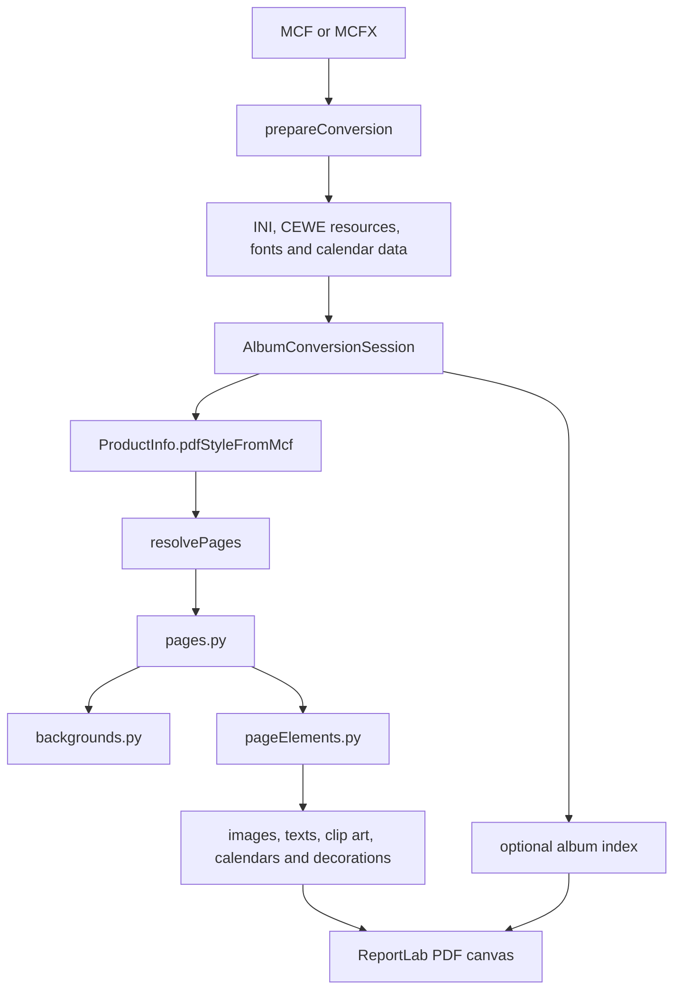

# Developer guide

This guide is for contributors working on the converter. It describes the current source layout, rendering model, and test workflow. User installation, command-line options, CEWE-resource configuration, and the standalone executable are documented in [README.md](../README.md).

The converter is a careful interpretation of an undocumented CEWE format. A small, well-tested change based on an MCF fixture is usually preferable to a large theoretical rewrite.

For working conventions, see [AGENTS.md](../AGENTS.md). For the reasons behind
important implementation choices, see [project context](PROJECT_CONTEXT.md).

## First steps

Prepare the [source environment](../README.md#install), then follow the
[test workflow](../tests/README.md#running-tests). Run commands from the repository root.

The public entry point is `convertMcf(...)` in [cewe2pdf.py](../cewe2pdf.py).
For an initial code reading, follow `albumConversionSession.py`, `conversionSetup.py`,
`ceweInfo.py`, `cewePageResolver.py`, then `pages.py`, `backgrounds.py`, and `pageElements.py`.

## Conversion model



`AlbumConversionSession` is the lifetime boundary. It prepares the album, creates and saves the ReportLab canvas, owns temporary files and diagnostic counters, and cleans those resources up even when rendering fails. Do not add conversion-time mutable globals: one Python process may convert several albums.

### Data ownership

| Object | Owns |
| --- | --- |
| `ConversionSetup` | Parsed MCF, merged configuration, resolved resource locations, registered fonts, line scales, and calendar data. These are normally fixed after setup. |
| `RenderContext` | Drawing settings and shared resources passed to renderers: unit scale, resolutions, image settings, clip art/passepartout locations, and line scales. |
| `ConversionState` | Mutable per-run caches, missing-resource reports, font substitutions, temporary files, and diagnostic counters. |
| `AlbumIndex` | Optional mutable index data, deliberately separate from general state. |

MCF geometry is in tenths of a millimetre; ReportLab geometry is in points. `RenderContext.mcf_to_reportlab` is the conversion factor. Area renderers translate to the area centre, rotate, then draw around `(0, 0)`.

## Product and page interpretation

`PdfProductStyle` describes the shape of the output PDF, not CEWE's product marketing name:

- `AlbumSingleSide` is the normal album output. CEWE stores a spread, while the PDF contains individual pages.
- `AlbumDoubleSide` is selected by `--keepdoublepages` for an album.
- `Calendar` represents independently rendered calendar cover/month pages.
- `MemoryCard` represents CEWE Photo Pairs (`MEM3`) cards.

`ProductInfo.pdfStyleFromMcf(...)` derives the style from MCF structure before using an identifier fallback. In particular, calendar cover/area tags are more reliable than retailer-specific CAL identifiers. Product IDs and `ceweFormats` are fallback/diagnostic information: actual `bundlesize` values on MCF pages determine normal rendering dimensions. A diagnostic warns when the product identifier and structure disagree or a known fallback differs substantially from the MCF.

### Album pages are asymmetric

CEWE album XML does not map cleanly to visible pages. `cewePageResolver.py` is the single location for this interpretation. It yields immutable `ResolvedPage` values; `pages.py` performs drawing and decides when to call `showPage()`.

- The composite `fullcover` MCF record supplies visible cover/spine artwork. The separate `spine` record is structural metadata and is not independently drawn.
- The opening `emptypage` record can hold the first real content page, while normal page 1 supplies its background. The resolver labels those operations `FrontInsideCoverBackground` and `OpeningContentPage`.
- The final normal page holds the closing content; the trailing `emptypage` is the back inside-cover/endpaper record. Both operations share the final PDF canvas where appropriate.
- In the normal single-page PDF the inside cover/endpaper pages are omitted. In a double-page PDF, their backgrounds default to the facing content-page background. `insideCoverWhite=True` instead reproduces CEWE's white printed endpapers.

When changing those rules, extend `tests/testCewePageResolver/test_cewePageResolver.py` first. Do not scatter tests for raw CEWE `pagenr` values into area renderers.

## Source layout

The top level retains the conversion spine and cross-cutting modules. Specialist packages keep feature code out of `pageElements.py`.

| Location | Responsibility |
| --- | --- |
| `calendars/` | Calendar area rendering; CEWE schemas/layouts; localised month, weekday, holiday, and personal-event data; layout substitutions. |
| `texts/` | CEWE HTML-like text, markup, lists, tabs, spacing, outlines, and text art. |
| `decorations/` | Borders, corners, passepartouts, and shadows used by image/text/clip-art areas. |
| `clipart/` | Clip-art catalogue lookup, area rendering, and CEWE `.clp` parsing. |
| `fonts/` | Font discovery/registration, OTF handling, and line-scale rules. |
| `indexing/` | The optional cewe2pdf-only album index. |
| `infrastructure/` | Configuration helpers, paths, version/build information, logging, and Windows Explorer integration. |
| `imageareas.py`, `imageUtils.py`, `imageExtractor.py` | Image-area rendering, shared image helpers, and image extraction. Image rendering remains top-level because it is tightly coupled to page-area traversal. |
| `colorUtils.py`, `colorFrame.py` | Shared CEWE colour decoding and colour-frame support. |
| `pageNumbering.py` | Optional page-number drawing. |

Package `__init__.py` files deliberately contain no public façade. Import the specific module which provides the operation you need.

`pageElements.py` paints areas in CEWE z-order and delegates to the specialist modules. Keep it a coordinator: put feature-specific interpretation and drawing in the appropriate package whenever possible.

## Calendars

The `calendars` package loads schemas, layouts, and locale resources during setup
only for calendar products. See [calendar rationale](PROJECT_CONTEXT.md#calendars)
for interpretation rules and [user configuration](../README.md#calendars) for local substitutions.

## Configuration and resources

`prepareConversion(...)` owns resource setup. The [user configuration guide](../README.md#configuration-files)
defines INI merge order, additional-font lookup, and system-font options.
Use the same loading mechanisms for installed and portable test resources; missing
CEWE resources should generate ordinary lookup diagnostics rather than a second rendering pipeline.

## Logging and diagnostics

`infrastructure/extraLoggers.py` defines named loggers:

- `cewe2pdf.mustsee` — short, user-visible conversion facts such as the product diagnostic and rendered side.
- `cewe2pdf.config` — configuration and font-resource diagnostics.
- `cewe2pdf.page_rendering` — focused debug trace of opening/closing content and inside-cover/endpaper backgrounds actually sent to the PDF canvas.

`loggerconfig.yaml` is read at import time from the **process working directory**, not beside the MCF or test file. It enables the focused `page_rendering` trace without enabling all root debug output. A Visual Studio test launch may use the project directory as its working directory; do not assume it uses the selected test's directory.

Explorer automatic mode writes `<album>.mcf.log` or `<album>.mcfx.log` beside the album. It attaches the automatic file handler to all named loggers that do not propagate, including `page_rendering`, so the same trace is retained after Explorer closes the console.

Use `mustsee` for important conversion facts, ordinary `logging` for general diagnostics, and a specialised named logger only for a coherent optional trace. Avoid adding high-volume detail to `mustsee`.

## Tests and approved output

The [test guide](../tests/README.md) owns test commands, fixtures, reference naming,
visual approval, comparison policy, and cleanup. The [comparison helper](../tests/compare-pdf/README.md)
owns its API and diagnostic measurements.

### Page selection API

The [user guide](../README.md#selecting-pages) defines CLI selection semantics.
The parser creates `PageSelection`; the public `convertMcf` argument retains its
historical `pageNumbers` name and also accepts an iterable of integers. Legacy zero
maps to `cover`. Keep that compatibility at the boundary rather than inside renderers.
Extend resolver tests when changing CEWE page interpretation.

## Linting

The GitHub workflow treats Python syntax/undefined-name flake8 findings as errors and reports broader style/complexity findings as warnings. Run:

```bash
python -m flake8 .
python -m pylint --rcfile=.pylintrc *.py calendars clipart decorations fonts indexing infrastructure texts
```

Use a local pylint suppression only when the parameter-rich rendering boundary is genuinely clearer than an artificial wrapper; explain the reason in a nearby comment.

## Working conventions

Use [AGENTS.md](../AGENTS.md) for coding/review conventions and the
[test guide](../tests/README.md#cleaning-up-temporary-files) for safe cleanup.
Treat diagnostics as user interface: state the useful fact in appropriate units,
include recovery advice when available, and avoid unsupported claims of pixel-perfect CEWE compatibility.

## Support boundary

The primary target is CEWE albums. Calendar pages and the Photo Pairs memory-card product have explicit support. CEWE-only or third-party features can be approximated, omitted with a warning, or unsupported. Keep that distinction visible in both code and documentation.

## Python dependencies

The project has three dependency files with distinct jobs:

- `requirements.txt` is maintained by hand. It lists the direct runtime,
  test and lint dependencies, with the ranges the project supports.
- `requirements-pinned.txt` is the generated lock file for that normal Python
  environment. It pins those packages and their dependencies to the exact
  versions which have been tested. Do not edit it by hand.
- `requirements-winexe.txt` is a small, exact Windows-only overlay on the
  pinned file. It supplies PyInstaller and its dependencies for developers
  building `cewe2pdf.exe`.

Create new environments using the [README installation procedure](../README.md#install).

GitHub Actions uses `requirements-pinned.txt` for linting and tests, and
`requirements-winexe.txt` for its separate Windows executable build. Therefore,
when a direct dependency is added or its supported range is changed in
`requirements.txt`, regenerate the pinned file, run the full tests and the
Windows executable build, and commit the related files together:

```
pip-compile --output-file=requirements-pinned.txt requirements.txt
```

After regenerating `requirements-pinned.txt`, preserve its PyInstaller-free
purpose: update `requirements-winexe.txt` only when a PyInstaller build
dependency changes. `pip-tools` is used only to maintain the lock file, rather
than to run or build cewe2pdf. Generate the lock with Python 3.12 in a separate
dependency-maintenance environment.
Record the pip/pip-tools versions used when updating the lock, and validate the
result rather than treating an old local tool version as a permanent requirement.

## Version numbering

Each conversion logs a user-facing program version and Git build
identification. The user-facing version is the manually maintained
`PROGRAM_VERSION` constant in [infrastructure/programversion.py](../infrastructure/programversion.py), currently in `m.n` form.
Incrementing `m` or `n` is intentionally a maintainer judgement, based on the
significance of the changes being merged into `bash0/cewe2pdf` master.

To display this information without converting an album, use:

```
python cewe2pdf.py --version
```

The same option is available from the standalone executable:

```
dist\cewe2pdf.exe --version
```

After the tests succeed for a commit pushed to canonical `bash0/cewe2pdf`
master, the GitHub workflow creates a tag of the form
`cewe2pdf-v<m.n>-build-<GitHub-run-number>`. Tags identify the exact tested
commit without making an automatic commit to master. They can be seen in the GitHub web
interface on the code tab:


Forks and branches run the
same checks but do not create canonical tags; fetch upstream tags to make their
nearest canonical build available locally.

Example log forms (the version and build numbers are illustrative):

```
>>> cewe2pdf version 1.0; Git identification: cewe2pdf-v1.0-build-178-0-g844e6d0
>>> cewe2pdf version 1.0; Git identification: cewe2pdf-v1.0-build-178-3-g844e6d0-dirty
>>> cewe2pdf version 1.0; Git identification: a046aed-dirty
```

The first form means that the working tree is exactly at the specified build.
The second form means that the working tree is 3 commits later than the specified build.
The third means that no matching build tag is available locally;
`a046aed` and the `g`-prefixed suffix identify abbreviated commit IDs.
`dirty` is a diagnostic indication that
the working tree has uncommitted changes, so it is not an approved reproducible
build. A source archive without `.git` metadata logs that Git identification
is unavailable. PyInstaller captures the Git description while building a
standalone executable and bundles it, so a normally built executable retains
the identification of its source build.

To reproduce an approved canonical build, clone the canonical repository,
fetch its tags, and check out the reported build tag:

```
git clone https://github.com/bash0/cewe2pdf.git
cd cewe2pdf
git fetch --tags
git checkout cewe2pdf-v1.0-build-184
```

This gives the exact source commit which passed the canonical test workflow.
Developers working in a fork can instead fetch the same tags from their
`upstream` remote.

